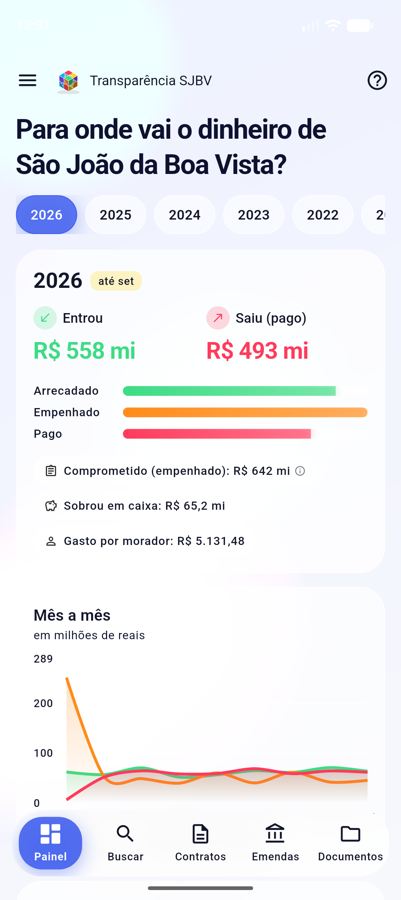
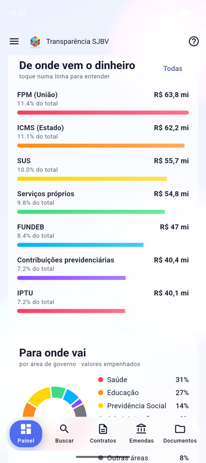

# Tô de Olho — transparência na palma da mão

> App cidadão **independente e de código aberto** (Android + iOS, Flutter) que reúne em uma interface simples tudo o que o Portal da Transparência da Prefeitura de São João da Boa Vista/SP publica — hoje espalhado em cinco sistemas de três fornecedores.
>
> ⚠️ Este app **não é da Prefeitura**. Todos os dados vêm das fontes oficiais públicas e exibem data/hora de obtenção e link para a origem.

## Por que

O cidadão que quer saber "quanto a prefeitura gastou com X" precisa descobrir em qual dos portais o ano está, aprender uma interface diferente em cada um e, no celular, desistir. Dados públicos só são transparência se qualquer pessoa consegue vê-los.

## Status

**Fase 2 — cobertura completa em andamento.** Tudo o que o app mostra vem de API oficial ao vivo ou de JSON regenerado **todo dia** pelo GitHub Actions a partir do site da Prefeitura, do TCE-SP, do SICONFI e do SAPL da Câmara — sem manutenção manual. Visual em vidro, Android + iOS, 23 telas cobertas por testes de fumaça.

| Seção | O que responde | Fonte |
|---|---|---|
| Painel | quanto entrou/saiu, de onde vem, para onde vai, quem recebe, por morador, 13 anos em um olhar | TCE-SP + SICONFI |
| Comparar | anos lado a lado; mandatos com placar por indicador (maior/menor, sem juízo) | TCE-SP + SICONFI |
| Limites da lei | gasto com pessoal (LRF) 2015→hoje; mínimos de saúde/educação (quando publicados) | SICONFI RGF/RREO |
| O que mudou · Vizinhos | receitas novas/sumidas, fornecedores novos; 6 cidades por habitante | TCE-SP |
| Obras | 35 obras no mapa, empresa, % pago, prazo, fotos | site `/obras` |
| Câmara | 19 vereadores com foto e partido; propostas, votos nominais, presença, emendas impositivas; sessões (vídeo, ata); leis | SAPL (API) |
| Salários | subsídios de prefeito, vice, vereadores e diretores com a lei; quadro de pessoal; folha; gastos da Câmara | SAPL + eCrie (PDF) + TCE-SP |
| Contratos · Emendas · Chamamentos | ~7.400 contratos com PDF; 103 emendas; 50 inexigibilidades explicadas | site |
| Cidade | interdições, trânsito, coleta, eventos, 85 reuniões de conselhos; 150 notícias; 27 unidades de saúde, 36 escolas, 22 departamentos, 25 conselhos | site + RSS |
| Documentos | 27 pastas de PDFs oficiais (balancetes, folha, concursos, Jornal Oficial…) | eCrie |
| Cobrar · Glossário · Mapa do site | pedido LAI pronto, ouvidoria, vereadores, conselhos; 35 termos; 187 seções do site | — | Veja o [roadmap](docs/04-roadmap.md).

<p align="center">
  
  
  
  
</p>

| Fonte | Período | Tecnologia | Mapeamento |
|---|---|---|---|
| SmarAPD PAI | 2026 → | API JSON | ✅ [endpoints](docs/api/smarapd-pai.md) · ⏳ amostras de resposta |
| Site da Prefeitura (contratos, emendas) | todos | HTML | ✅ [seletores](docs/api/site-prefeitura.md) |
| Arquivos legados (eCrie) | ≤ 2022 | HTML (árvore) | ✅ [22 pastas](docs/api/site-prefeitura.md#3-transparência-até-2022--arquivos-file-browser-ecrie) |
| Intertec GPMOD | 2023–2025 | Oracle APEX | ⛔ [fora do ar](docs/api/intertec-gpmod.md) |
| **TCE-SP + SICONFI** | 2014 → | API JSON | ✅ [agregados diários](dados/README.md) — base do painel |

## Estrutura do repositório

```
apps/mobile/        app Flutter (Android + iOS)
packages/fontes/    adaptadores Dart puro: SmarAPD, site da Prefeitura, eCrie
                    └ test/fixtures/   HTML/JSON reais capturados, com data
docs/               viabilidade, fontes, arquitetura, roadmap, mapa das APIs
.github/workflows/  CI (analyze + test) e smoke diário contra as fontes
```

```bash
# testes dos adaptadores (sem Flutter)
cd packages/fontes && dart pub get && dart test

# app
cd apps/mobile && flutter pub get && flutter run
```

## Documentação

1. [Viabilidade](docs/01-viabilidade.md) — é possível? sim; com quais ressalvas
2. [Fontes de dados](docs/02-fontes-de-dados.md) — o mapa dos cinco sistemas
3. [Arquitetura](docs/03-arquitetura.md) — Flutter sem backend, adaptadores por fonte, config remota
4. [Roadmap](docs/04-roadmap.md)
5. [Mapa do site da Prefeitura](docs/05-mapa-site-prefeitura.md) · [Inventário completo (901 páginas) e backlog de 23 features](docs/06-inventario-site-e-features.md)
6. APIs: [SmarAPD](docs/api/smarapd-pai.md) · [Site/eCrie](docs/api/site-prefeitura.md) · [Intertec](docs/api/intertec-gpmod.md)

## Como ajudar

Leia o [CONTRIBUTING.md](CONTRIBUTING.md). A contribuição mais valiosa agora é **capturar amostras reais da API SmarAPD** (um HAR do DevTools basta) — instruções [aqui](docs/api/smarapd-pai.md#como-capturar-os-formatos-de-resposta-próximo-passo).

## Base legal

Lei de Acesso à Informação (12.527/2011, art. 8º §3º II e III), Lei Complementar 131/2009 e Decreto 7.185/2010 determinam a publicação desses dados em formato aberto e com acesso automatizado por sistemas externos.

## Licença

[MIT](LICENSE). Os dados pertencem ao público.
